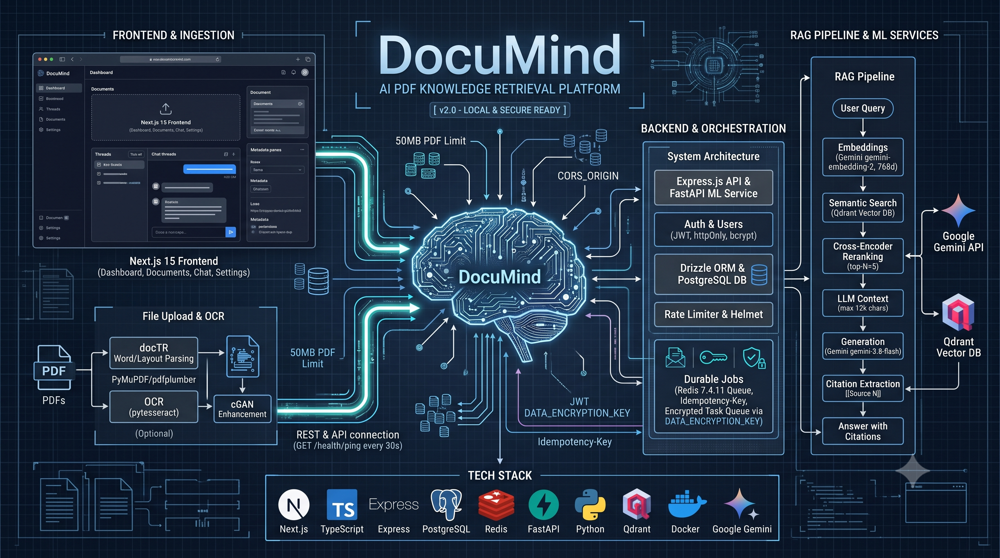
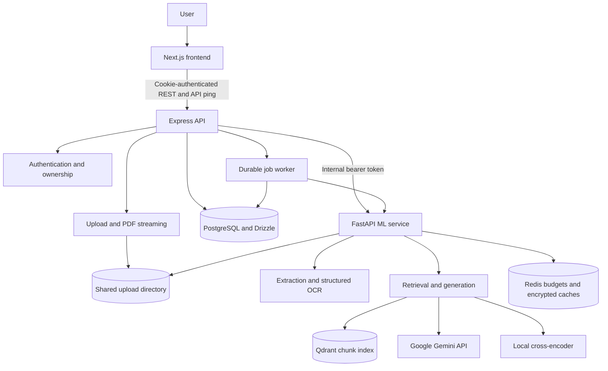
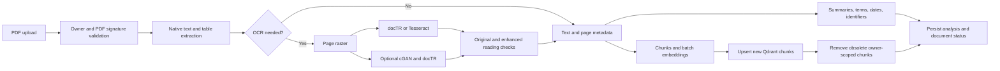
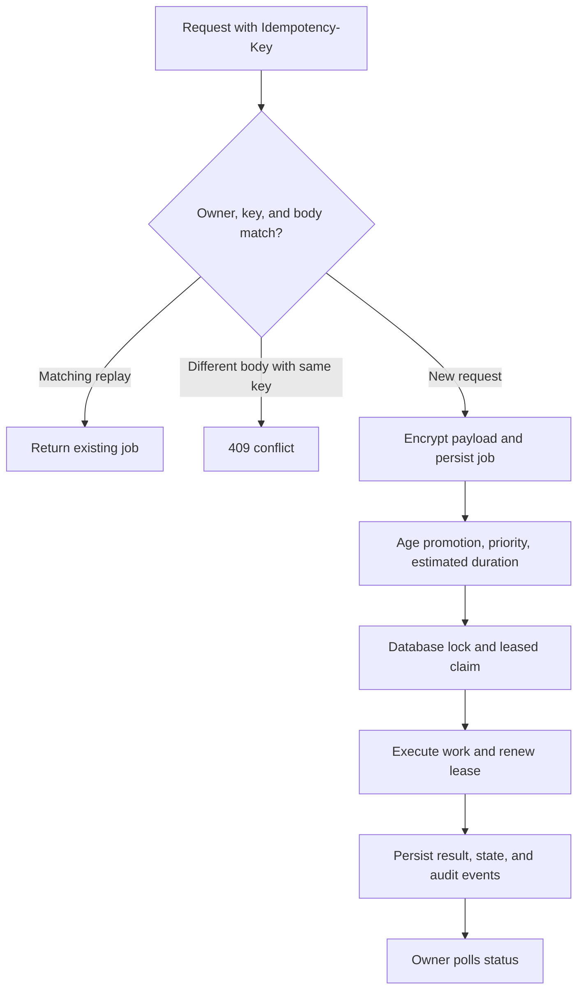

<div align="center">

# 🧠 DocuMind PDF Orchestrator

### A document workspace for structured OCR, searchable knowledge, and grounded answers

Upload PDFs, inspect extracted text and layout, review important dates and identifiers, and ask questions with source citations.

[](frontend/package.json)
[](frontend/package.json)
[](backend/package.json)
[](ml-service/requirements.txt)
[](ml-service/Dockerfile)
[](docker-compose.yml)
[](docker-compose.yml)
[](ml-service/app/vector/qdrant_client.py)

<br />



<br />

**[Quick Start](#-quick-start)** · **[Features](#-core-features)** · **[Architecture](#-system-architecture)** · **[API](#-api-overview)** · **[Testing](#-testing-and-quality-checks)** · **[Documentation](#-engineering-documentation)**

</div>

---

## 📌 Project Overview

**DocuMind** is a three-service PDF knowledge application: Next.js provides the workspace, Express handles accounts/documents/conversations, and FastAPI performs extraction and inference.

```text
PDF → Extract / OCR → Analyze → Chunk → Embed → Index
                                                 ↓
Question → Retrieve → Rerank → Build Context → Generate → Answer + Citations
```

PostgreSQL stores users, documents, conversations, and durable jobs. Qdrant stores searchable chunks. Redis supports provider budgets and encrypted inference caches. The browser communicates with Express; Gemini credentials and internal ML tokens stay server-side.

> [!IMPORTANT]
> Local health is not public-production certification. OCR confidence is not measured transcription accuracy. Optional cGAN enhancement requires trusted document-trained weights. `check pnr` extracts information from the uploaded PDF—it does not check live railway booking status. Read [Security Overview](SECURITY_OVERVIEW.md) before deployment.

---

## ✨ Core Features

| Module | What it provides |
|---|---|
| 🏠 **Editorial Homepage** | An introduction to the application and document-processing workflows. |
| 📊 **Dashboard** | Document counts, processing states, recent documents, and upload/chat shortcuts. |
| 📄 **Document Library** | Owner-scoped PDFs, original filenames, status feedback, deletion, and reindexing. |
| 🔎 **PDF Preview** | Authenticated PDF streaming, page navigation, zoom, and a locally served PDF.js worker. |
| 📝 **Upload Analysis** | Per-page extractive summaries, tokenized terms, dates, identifiers, and OCR metrics. |
| 🧩 **Structured OCR** | docTR word/block/line JSON, normalized coordinates, and confidence metadata. |
| 🛠️ **Optional cGAN** | CycleGAN/pix2pix enhancement with original-versus-enhanced reading checks and fallback. |
| 💬 **Document Chat** | Questions scoped to selected PDFs, recent conversation context, and source citations. |
| ⚡ **Durable Requests** | PostgreSQL-backed jobs, idempotency, leases, progress events, and owner-protected polling. |
| 🚦 **Provider Coordination** | Redis budgets, encrypted user-scoped caches, and configured Gemini rate-limit fallbacks. |
| 🔐 **Authentication** | Cookie-based login/logout, registration, bcrypt hashing, and ownership checks. |
| 🔌 **API Connectivity** | API identity handshake, visible status, reconnect/focus checks, and retry. |
| ⚙️ **Profile Settings** | Persistent name updates; account deletion is not implemented. |

### Reading and extraction limits

- Page summaries are extractive, not a guaranteed comprehensive generative report.
- Dates/identifiers are tied to source pages; ambiguous associations require checking the PDF.
- OCR confidence is diagnostic, not ground-truth CER/WER.
- Enhancement warnings report missing words, changed numbers, reduced confidence, or unavailable resources.
- Original source PDFs are preserved; reindex older documents to generate updated analysis.

---

## 🏗️ System Architecture



### PDF ingestion and structured OCR



docTR uses `db_resnet50` detection and `crnn_vgg16_bn` recognition. Optional enhancement imports the generator from `pytorch-cyclegan-and-pix2pix`; it does not train a GAN automatically or include cleanup weights. Preservation checks retain the original reading when enhancement loses content, changes numeric fields, lowers confidence, or is unavailable. These checks are heuristics, not a no-data-loss guarantee.

See [OCR Architecture](OCR_ARCHITECTURE.md) for installation, trusted checkpoints, and CER/WER benchmarking.

### Retrieval-augmented generation

```mermaid
flowchart LR
    Q[Question and last four messages] --> E[Query embedding]
    E --> V[Owner and document filtered retrieval]
    V --> R[Cross-encoder reranking]
    R --> C[Bounded context and system prompt]
    C --> G[Gemini generation]
    G --> X[Citation extraction and normalization]
    X --> S[Atomic conversation persistence]
    S --> A[Answer and citations]
```



| Parameter | Repository default |
|---|---|
| Chunk size / overlap | 1,000 / 200 characters |
| Embedding model / dimensions | `gemini-embedding-2` / 768 |
| Qdrant collection | `rag_documents_v2` |
| Retrieval / reranking | Top 10 retrieved; top 5 retained |
| Reranker | `cross-encoder/ms-marco-MiniLM-L-6-v2` |
| Context limit | 12,000 characters |
| Generation model | `gemini-3.8-flash` |
| Configured fallbacks | `gemini-3.7-flash`, `gemini-3.5-flash` |
| Temperature / output limit | 0.2 / 2,048 tokens |

These are configuration defaults, not a live model-availability or quota claim. Verify model access for your Gemini project. The prompt treats document text as data and ignores instructions embedded in documents. Refusal answers do not receive fallback citations.

[ML settings](ml-service/app/core/config.py) remap exact legacy model/collection values in memory. Reindex documents into the current collection; the legacy collection is not automatically deleted.

### Priority and shortest-job scheduling



- Chat uses priority `0`; document processing uses priority `1`.
- Within non-aged tiers, shorter estimated jobs run before longer jobs.
- Requests waiting more than five minutes receive aging promotion.
- Scheduling is **non-preemptive estimated SJF**, not shortest-remaining-time scheduling.
- PostgreSQL is the durable queue. Redis supports coordination/cache, not authoritative job storage.
- Leases, heartbeats, and replay support recovery; Gemini, Qdrant, PostgreSQL, and files do not share one distributed ACID transaction.

---

## 🛠️ Technology Stack

| Layer | Technology |
|---|---|
| Frontend | Next.js 15, React 18, TypeScript 5, App Router |
| UI and forms | Tailwind CSS 4, CSS Modules, Radix/shadcn-style components, Lucide, React Hook Form, Zod |
| Client data | TanStack Query 5 and Axios |
| PDF viewing | react-pdf 10 and a build-copied local PDF.js worker |
| Backend | Express 4, TypeScript, Drizzle ORM, PostgreSQL |
| Inference API | FastAPI 0.142.4, Pydantic 2, Uvicorn, Python 3.11 |
| PDF extraction | PyMuPDF, pdfplumber, pytesseract, Pillow |
| Neural OCR | python-doctr, PyTorch, torchvision; optional CycleGAN/pix2pix generator |
| Gemini client | `google-genai==2.26.0` |
| Retrieval | Qdrant client 1.19.1, sentence-transformers, cross-encoder reranking |
| Coordination | Node/Python Redis clients and PostgreSQL job leases |
| Security | JWT cookies, bcrypt, AES-256-GCM, keyed fingerprints, Helmet, strict CORS |
| Testing | Jest, Supertest, pytest, lint/types/build and browser checks |
| Deployment | Docker Compose; project-specific Windows/WSL scripts |

Exact constraints: [frontend/package.json](frontend/package.json), [backend/package.json](backend/package.json), [requirements.txt](ml-service/requirements.txt), [requirements-ocr.txt](ml-service/requirements-ocr.txt).

---

## 🚀 Quick Start

### Prerequisites

- Node.js 22 and npm for the tested Node runtime.
- Python 3.11 and an appropriate PyTorch installation for neural OCR.
- PostgreSQL, Qdrant, and Redis for the full queued workflow.
- A Gemini API key with access to the configured generation and embedding models.
- Tesseract installed separately if using `OCR_BACKEND=tesseract`.

### 1. Clone and configure

```bash
git clone https://github.com/devendrarajsingh07/Pdf-with-Ai-Rag.git
cd Pdf-with-Ai-Rag
cp .env.example .env
cp backend/.env.example backend/.env
cp ml-service/.env.example ml-service/.env
cp frontend/.env.local.example frontend/.env.local
```

Copy examples only on a new installation. Preserve existing files and replace placeholder credentials. Backend and ML need the same internal token. Redis-backed encryption requires a separate, retained base64-encoded 32-byte key—not the Gemini API key.

### 2. Install application dependencies

```bash
npm --prefix backend ci
npm --prefix frontend ci
python -m pip install -r ml-service/requirements.txt
python -m pip install -r ml-service/requirements-ocr.txt
```

Neural OCR requirements are optional when using the configured Tesseract backend. OCR/reranking weights may download on first use. cGAN additionally requires the trusted upstream checkout and document-trained weights described in [OCR Architecture](OCR_ARCHITECTURE.md).

### 3. Run the services separately

Start host-reachable infrastructure, then run each app in its own terminal:

```bash
# Backend (after PostgreSQL is available)
cd backend
npm run build
npm run db:migrate
npm run dev
```

```bash
# ML service (after Qdrant is available)
cd ml-service
python -m uvicorn app.main:app --reload --host 127.0.0.1 --port 8000
```

```bash
# Frontend
cd frontend
npm run dev
```

Host-run services need host-reachable database/Redis URLs; Compose internal service names are not host DNS names. Direct mode is available with `QUEUE_ENABLED=false`. Full queue mode requires Redis and the shared encryption key in backend and ML configuration.

| Service | Default URL |
|---|---|
| Frontend | [http://localhost:3000](http://localhost:3000) |
| Express liveness | [http://localhost:3001/api/v1/health](http://localhost:3001/api/v1/health) |
| API handshake | [http://localhost:3001/api/v1/health/ping](http://localhost:3001/api/v1/health/ping) |
| Dependency readiness | [http://localhost:3001/api/v1/health/readiness](http://localhost:3001/api/v1/health/readiness) |
| ML health | [http://localhost:8000/api/v1/ml/health](http://localhost:8000/api/v1/ml/health) |
| ML OpenAPI docs | [http://localhost:8000/docs](http://localhost:8000/docs) |

### Existing Windows / WSL installation

The native launcher expects project-local dependencies and PostgreSQL/Qdrant binaries **not included in Git**. It is not a fresh-clone installer.

```powershell
# Ubuntu-24.04 WSL and project-local dependencies must already exist.
./scripts/install-local-redis.ps1 # first installation only
./scripts/start-secure-local.ps1 -DatabasePort 5434
./scripts/verify-local-redis.ps1

# Later starts, with current compiled output:
./scripts/start-secure-local.ps1 -SkipBuild -DatabasePort 5434
```

Port `5434` avoids the WSL PostgreSQL listener encountered on the verified host. The override changes inherited runtime database host/port, not `.env` or credentials. Secure startup authenticates Redis, builds unless skipped, applies migrations, starts services in hidden windows, and checks readiness. It restarts recognized backend/ML listeners and stops a recognized frontend before rebuilding. Unrelated listeners are not forcibly stopped.

Redis uses loopback port `6380`, password authentication, AOF `everysec`, a 256 MiB cap, and `noeviction`. Secrets are retained in ignored `.tools/secrets/runtime-secrets.clixml`, restricted to owner/SYSTEM and Windows CurrentUser DPAPI protected. Do not regenerate the encryption key while encrypted jobs exist; the file alone is not a portable backup.

Cold ML initialization can exceed the script's wait window. Check `.tools/ml-service.err.log` and actual health before retrying; a timeout does not prove Python exited. Stop a verified frontend before manually rebuilding its standalone output on Windows.

---

## 🐳 Docker Compose

Compose defines PostgreSQL 16, Redis 7.4, Qdrant, Express, FastAPI, Next.js, and an isolated test database.

```bash
docker compose up -d --build
docker compose exec backend npm run db:migrate
```

Set root `POSTGRES_DB`, `POSTGRES_USER`, `POSTGRES_PASSWORD`, `REDIS_PASSWORD`, and `DATA_ENCRYPTION_KEY`. Backend/ML files supply their other application secrets. Compose shares the upload volume and enables queue mode.

> [!NOTE]
> Docker is configured but was not built on the verified Windows host. `NEXT_PUBLIC_API_URL` is compiled into the browser bundle; the current Docker build uses the localhost default. Runtime-only changes do not retarget an existing build. Review build-time API configuration before deploying elsewhere.

Do not use `docker compose down -v` when preserving uploads, databases, or vectors.

### Environment configuration

| Area | Main variables |
|---|---|
| Database/auth | `DATABASE_URL`, `JWT_SECRET`, `JWT_EXPIRES_IN`, `ML_SERVICE_TOKEN` |
| API connection | `PORT`, `CORS_ORIGIN`, `ML_SERVICE_URL`, `NEXT_PUBLIC_API_URL` |
| Files | `UPLOAD_DIR`, `MAX_FILE_SIZE` |
| Queue/encryption | `QUEUE_ENABLED`, `REDIS_URL`, `DATA_ENCRYPTION_KEY`, `QUEUE_CONCURRENCY`, `USER_API_REQUESTS_PER_MINUTE` |
| Gemini | `GEMINI_API_KEY`, `LLM_MODEL`, `LLM_FALLBACK_MODELS`, `LLM_TEMPERATURE`, `LLM_MAX_OUTPUT_TOKENS` |
| Provider budgets | `GEMINI_REQUESTS_PER_MINUTE`, `GEMINI_TOKENS_PER_MINUTE`, `GEMINI_PROJECT_REQUESTS_PER_MINUTE` |
| Retrieval | `EMBEDDING_MODEL`, `EMBEDDING_DIMENSION`, `QDRANT_URL`, `QDRANT_API_KEY`, `QDRANT_COLLECTION`, `RERANKER_MODEL`, `RERANKER_ENABLED` |
| Chunking | `CHUNK_SIZE`, `CHUNK_OVERLAP`, `RETRIEVAL_TOP_K`, `RETRIEVAL_TOP_N` |
| OCR | `OCR_BACKEND`, `OCR_DEVICE`, `OCR_TORCH_THREADS`, `TESSERACT_CMD`, `CGAN_REPO_DIR`, `CGAN_CHECKPOINT`, `CGAN_CHECKPOINT_SHA256` |

Additional provider, logging, and cGAN architecture/tile settings are in the committed example files and [ML settings](ml-service/app/core/config.py). Never commit real environment files or secrets.

---

## 🔌 API Overview

### Express API — `/api/v1`

Protected routes use the `token` cookie. Login sets an httpOnly cookie and returns user data, not the token. Mutations require an allowed `Origin`.

| Area | Endpoints |
|---|---|
| Authentication | `POST /auth/register`, `POST /auth/login`, `POST /auth/logout`, `GET /auth/me` |
| Profile | `GET /users/me`, `PATCH /users/me` |
| Document collection | `GET /documents`, `POST /documents`, `POST /documents/upload` (alias) |
| Document operations | `GET /documents/:id`, `GET /documents/:id/status`, `GET /documents/:id/file`, `POST /documents/:id/reindex`, `DELETE /documents/:id` |
| Sessions | `POST /chat`, `GET /chat`, `GET /chat/:id`, `DELETE /chat/:id` |
| Messages | `GET /chat/:id/messages`, `POST /chat/:id/messages` |
| Jobs | `GET /jobs/:id` |
| Health | `GET /health`, `GET /health/ping`, `GET /health/ml`, `GET /health/readiness` |

Uploads use multipart field `file`. Message sends use:

```json
{
  "question": "What dates and reference numbers are listed in this document?"
}
```

In queue mode, upload/reindex/message requests require `Idempotency-Key`. Retain the key and body when retrying. Queued chat returns `202` with a job ID; the frontend polls `/jobs/:id`. Matching owner/key/body replays reuse the job; changed bodies with the same key return `409`.

[REQUEST_TRANSACTION.schema.json](REQUEST_TRANSACTION.schema.json) documents the owner-visible status/audit envelope. Document responses omit internal file paths and ML IDs. File streaming separately checks ownership. Express errors expose `error.message` and an error code.

### FastAPI ML service — `/api/v1/ml`

| Area | Endpoints |
|---|---|
| Ingestion | `POST /documents/process`, `POST /documents/reindex` |
| Indexed state | `GET /documents/{document_id}/chunks`, `GET /documents/{document_id}/completion` |
| Removal | `DELETE /documents/{document_id}` |
| Retrieval/generation | `POST /retrieve`, `POST /chat` |
| Liveness | `GET /health` |

ML health is unauthenticated. Other ML application routes require an internal bearer token and owner/request parameters where specified by the route. These are backend-to-ML calls, not browser calls. Interactive schemas are available at `/docs`; protect internal service exposure in deployed environments.

### API connectivity semantics

The browser pings `/health/ping` every 30 seconds while visible, with a five-second timeout, plus focus/reconnect/manual retry checks. It validates `documind-api` / `v1`. This proves API reachability only.

`/health` reports Express uptime without querying PostgreSQL. `/health/readiness` checks database, ML, Redis, and queue mode; it can return `503` in direct mode. None of these checks proves Gemini access/quota or OCR accuracy.

---

## 🔐 Security and Data Integrity

- Passwords use bcrypt hashing, not reversible encryption.
- JWT cookies are httpOnly, SameSite `lax`, and Secure in production.
- Credentialed CORS and mutations share an exact allowlist, without wildcards or arbitrary origin reflection.
- ML startup requires an internal token of at least 32 characters, checked with constant-time comparison.
- Uploads validate MIME type, size, and `%PDF-`; ML confines real paths to the upload directory.
- Qdrant operations apply owner/document scope; startup validates collection size/distance.
- Job payloads/results and supported Redis caches use AES-256-GCM; idempotency/body fingerprints use keyed hashing.
- Local PostgreSQL transactions protect conversation/job state; replay/recovery coordinates remote effects.
- Defaults: 600 general requests/15 minutes, 10 login/register attempts/15 minutes, 20 chat sends/user/minute, and 3 uploads/user/minute. Queue/provider budgets add separate controls.
- cGAN checkpoints and upstream code must be trusted. Preservation checks are heuristic.

Uploads, document-analysis JSONB, and vectors are **not universally encrypted at rest** by queue/cache encryption. Public deployment still needs TLS, network isolation, secret management, resource limits, backup/key restoration testing, and a fresh vulnerability review.

See [SECURITY_OVERVIEW.md](SECURITY_OVERVIEW.md) for detailed controls and remaining risks.

---

## 🧪 Testing and Quality Checks

### Backend — isolated test database only

Set root `POSTGRES_TEST_*` values, then:

```bash
docker compose --profile test up -d postgres-test
```

```powershell
cd backend
$env:DATABASE_URL = "postgresql://<test-user>:<test-password>@localhost:5433/<test-database>"
npm run build
npm run db:migrate
npm test
```

Tests perform destructive cleanup and refuse to run unless the database name contains `test`. Upload tests use a fresh temporary directory. Never target the application database.

Coverage includes authentication, mocked-ML chat, cross-user access, documents/status/delete/reindex, upload rejection, jobs, and connectivity/CORS.

### ML tests

```bash
cd ml-service
python -m pytest tests/ -v
```

Coverage includes extraction, chunk progress, embeddings, RAG, schemas, analysis, provider control, and OCR safeguards. Unit tests are not a real scanned-PDF accuracy benchmark; use the OCR benchmarking instructions for CER/WER.

### Frontend validation

```bash
cd frontend
npm run lint
npx tsc --noEmit
npm run build
```

Historical verification is in [VERIFICATION_REPORT.md](VERIFICATION_REPORT.md), [Security Overview](SECURITY_OVERVIEW.md), and design documents. Later focused checks passed five CORS/ping tests, frontend lint/types/build, backend build, and desktop/mobile connectivity scenarios. These records do not mean all tests/audits were rerun for this README-only change.

---

## 📁 Project Structure

```text
Pdf-with-Ai-Rag/
├── frontend/
│   ├── public/                  # Editorial artwork, guide PDF, generated worker
│   ├── scripts/                 # Worker copy and standalone startup
│   ├── src/
│   │   ├── app/                 # Homepage, auth, protected routes
│   │   ├── components/          # Home, workspace, documents, chat, UI
│   │   ├── hooks/               # TanStack Query API workflows
│   │   ├── lib/                 # API client and utilities
│   │   └── types/               # Frontend contracts
│   └── package.json
├── backend/
│   ├── drizzle/                 # Committed migrations and metadata
│   ├── src/
│   │   ├── config/              # Environment, database, CORS
│   │   ├── models/              # Drizzle schemas
│   │   ├── middleware/          # Auth, uploads, origin, idempotency, errors
│   │   ├── services/            # Business logic, ML client, queue, encryption
│   │   ├── controllers/         # Request handling
│   │   ├── routes/              # Endpoints and connectivity tests
│   │   ├── validators/          # Zod validation
│   │   └── db/                  # Migration runner
│   ├── tests/                   # Guarded Jest suites
│   └── package.json
├── ml-service/
│   ├── app/
│   │   ├── core/                # Settings, auth, provider control, logging
│   │   ├── api/                 # FastAPI endpoints
│   │   ├── schemas/             # Request/response models
│   │   ├── services/            # OCR, analysis, embeddings, retrieval, generation
│   │   ├── rag/                 # Pipeline and prompts
│   │   └── vector/              # Qdrant integration
│   ├── tests/                   # pytest coverage
│   ├── scripts/                 # OCR benchmarking
│   └── requirements*.txt
├── scripts/                     # Secure Windows/WSL startup and Redis checks
├── docs/                        # PRDs, architecture, design references
│   └── assets/                  # README banner
├── docker-compose.yml           # Services, volumes, test database
├── .env.example                 # Placeholder configuration
├── PROJECT_CONTEXT.md           # Engineering context snapshot
├── OCR_ARCHITECTURE.md           # OCR/cGAN safeguards and benchmarking
├── SECURITY_OVERVIEW.md          # Security boundaries and operational risks
├── VERIFICATION_REPORT.md        # Historical verification
├── REQUEST_TRANSACTION.schema.json
└── README.md
```

Ignored local directories include `.tools/`, `uploads/`, `postgres-bin/`, `postgres-data/`, `qdrant-server/`, dependencies, and build output. They are not delivered by cloning GitHub.

---

## 🧭 Application Routes

| Route | Purpose |
|---|---|
| `/` | Editorial introduction |
| `/login` | Sign in and check API connectivity |
| `/register` | Register with an eight-character minimum password |
| `/dashboard` | Overview and quick actions |
| `/documents` | Browse and manage owned PDFs |
| `/documents/[id]` | Preview, inspect analysis, reindex, and start chat |
| `/chat/[id]` | Query a session's selected documents |
| `/settings` | Profile name and account information |

---

## 🛠️ Troubleshooting

### Frontend cannot reach the API

1. Check `/api/v1/health/ping` on the configured backend port.
2. Confirm frontend `NEXT_PUBLIC_API_URL` includes `/api/v1`.
3. Match `CORS_ORIGIN` to the exact browser origin. Comma-separated entries must be HTTP(S) origins without paths, wildcards, or trailing slashes.
4. Use `localhost` consistently; mixing it with `127.0.0.1` can stop SameSite cookies.
5. Rebuild/restart Next.js after changing public API settings.

Network failures display a connection error, not `Invalid credentials`. A real `401 INVALID_CREDENTIALS` still means the account/password was rejected; starting services does not reset passwords.

### Database authentication fails on Windows

Check the owner of port `5432`. On the verified host it was a WSL relay, not the project's PostgreSQL. Use the secure launcher with `-DatabasePort 5434` where appropriate. Do not change passwords or delete data to solve a listener conflict.

### Processing fails or OCR misses information

- Confirm the file exists inside the shared upload directory and has a PDF signature.
- Check status metadata/logs without posting secrets or private document text.
- Verify OCR dependencies, model weights, Gemini access/budgets, and Qdrant dimensions.
- Reindex older documents for updated analysis and embeddings.
- Verify critical dates/identifiers against the original PDF; confidence alone is insufficient.

### Queue mode is not ready

Readiness requires database, ML, Redis, and queue mode. Verify Redis authentication, `QUEUE_ENABLED`, and the shared retained encryption key. Never generate a replacement key over existing encrypted jobs.

### Database schema is out of date

```bash
cd backend
npm run build
npm run db:migrate
```

Apply committed migrations rather than destructively replacing an existing schema.

---

## 📚 Engineering Documentation

| Document | Purpose |
|---|---|
| [Project Context](PROJECT_CONTEXT.md) | Source-oriented onboarding snapshot; current code governs subsequent changes. |
| [Application PRD](docs/PRD_APPLICATION.md) | User-facing workflows. |
| [Orchestration PRD](docs/PRD_ORCHESTRATION.md) | Scheduling, idempotency, request lifecycle. |
| [OCR/RAG PRD](docs/PRD_OCR_RAG.md) | Extraction, structured OCR, retrieval, generation. |
| [Security/Operations PRD](docs/PRD_SECURITY_OPERATIONS.md) | Security and operational controls. |
| [Main PRD](docs/PRD.md) | Consolidated specification. |
| [Production Architecture](docs/PRODUCTION_ARCHITECTURE.md) | Architecture and Mermaid diagrams. |
| [OCR Architecture](OCR_ARCHITECTURE.md) | Neural OCR, cGAN, benchmarks. |
| [Security Overview](SECURITY_OVERVIEW.md) | Controls, limitations, deployment risks. |
| [Verification Report](VERIFICATION_REPORT.md) | Historical checks and scope. |
| [Homepage Design](docs/HOMEPAGE_DESIGN.md) / [Workspace Design](docs/WORKSPACE_DESIGN.md) | Visual direction and UI verification. |

---

## 🤝 Contributing

1. Create a focused branch and scope changes to one workflow.
2. Preserve owner isolation and typed API contracts.
3. Add regression tests for behavioral changes.
4. Run frontend lint/types/build, backend build/tests against an isolated database, and ML pytest.
5. Describe user-visible impact, verification, and limitations in your pull request.

Do not commit user PDFs, databases, API keys, runtime secrets, checkpoints, or build/dependency directories.

---

## 📄 Assets and Licensing

The supplied DocuMind banner is an illustrative architecture overview, not a live status/configuration report. Frontend artwork and design references are included under `frontend/public/` and `docs/`.

No project-level `LICENSE` file is committed, so this README does not claim an MIT or other license grant. Dependencies, pretrained weights, and optional upstream GAN code retain their own licensing requirements.

---

<div align="center">

### Built to make PDF knowledge searchable, inspectable, and traceable to its source.

Created by [Devendra Raj Singh](https://github.com/devendrarajsingh07)

</div>
