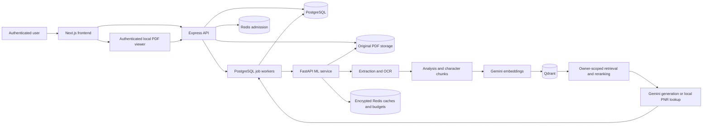
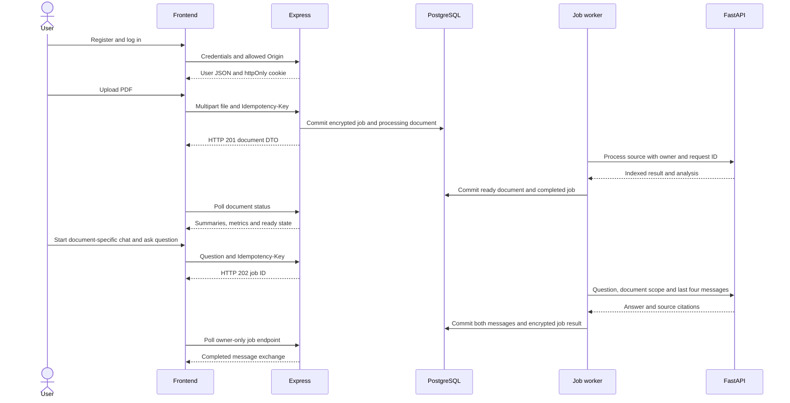

# Smart PDF Orchestrator: implemented-change PRD

Snapshot: 2026-10-08. This is an **as-built product requirements and change explanation**, not a proposal that every feature is production-certified.

## How to read this pack

1. [Application workflow PRD](PRD_APPLICATION.md): visible behavior, API contracts, authentication, PDF viewing and persistence.
2. [OCR and RAG PRD](PRD_OCR_RAG.md): extraction, neural OCR, optional cGAN, summaries, tokenization, retrieval and Gemini inference.
3. [Orchestration PRD](PRD_ORCHESTRATION.md): idempotency, encryption, Redis limits/caches, scheduling, job state and transaction boundaries.
4. [Security and operations PRD](PRD_SECURITY_OPERATIONS.md): security controls, dependency changes, migrations, deployment, tests and unfinished requirements.

Each requirement has an ID, implemented behavior, source reference and an acceptance condition. Conditions describe what to verify; they are not all claims of independently executed acceptance tests. The final document separates recorded test results from outstanding verification.

## Evidence and scope

The current source, manifests, migration files and scripts are authoritative. `VERIFICATION_REPORT.md` records the earlier 2026-10-07 repair; `PROJECT_CONTEXT.md`, `OCR_ARCHITECTURE.md` and `SECURITY_OVERVIEW.md` contain subsequent snapshots/addenda. Older claims about missing Redis, disabled native queues and dependency advisories are superseded by current code and the latest remediation.

There is no Git repository or original pre-change snapshot in this workspace. Therefore this pack catalogs every functional/algorithm change identifiable from current code and available implementation records; it cannot certify a complete historical line-by-line diff, exact authorship, or the original cause of every screenshot. Existing functionality is marked as context where its introduction cannot be established. No source, runtime configuration, credentials or original PDFs are changed by this documentation task.

## Purpose and users

Authenticated users upload their PDFs, inspect extracted summaries and quality indicators, and ask source-grounded questions across selected documents. The product addresses image-only/mixed PDF extraction, unreliable short PNR retrieval, mismatched frontend/backend contracts, provider limits, repeated requests and interrupted processing. The source does not specify a narrower target industry or guaranteed OCR accuracy.

## Product boundaries

| Implemented | Optional or limited | Not implemented / not guaranteed |
|---|---|---|
| Authenticated uploads, PDF preview, chats and citations | Direct processing remains available when queue mode is disabled | Live railway PNR lookup |
| All-page extractive summaries, dates/terms and PNR extraction | docTR layout; Tesseract fallback | Semantic table/invoice parsing or a generative whole-PDF upload narrative |
| Durable PostgreSQL jobs and real local Redis | cGAN inference adapter requires trusted trained weights | cGAN training, supplied cleanup checkpoint or proven messy-PDF quality gains |
| User admission, provider budgets, encrypted caches and fallback generation | Estimates use characters/file bytes, not measured service time | Exact provider quota accounting, unlimited throughput or preemptive SJTF |
| Atomic local DB completion and integrity checks | Source PDFs retained for retries | Distributed ACID, exactly-once Gemini billing, universally encrypted user data |
| Local dependency audits and functional verification | Docker configuration exists but Docker is absent locally | Public-production certification or tested disaster recovery |

## System map

Redis is **not** the authoritative queue. PostgreSQL stores jobs, leases and completion records. Qdrant stores vectors and readable chunk payloads. Native runtime and Compose are alternative deployment paths; they are not both verified deployments.

## Change timeline and coverage map

| Workstream | Changes covered | Requirement IDs |
|---|---|---|
| End-to-end repairs | Message payload/typing, citation casing, original filenames, DTO, file streaming, local worker, errors, registration, upload transport, path resolution, settings and UI controls | APP-01 through APP-15 |
| RAG correctness | Progress-safe splitter, batched/retried valid embeddings, safe vector replacement, history, prompts/limits, refusal citations, collection validation, scoped deletion and blocking handlers | OCR-01 through OCR-09; RAG-01 through RAG-10 |
| OCR/PNR enhancement | Native/hybrid preservation, confidence diagnostics, all-page summaries, lexical markup, coordinate PNR recovery, exact-intent lookup, neural layout and optional guarded GAN | OCR-01 through OCR-09; RAG-06 |
| Redis/request coordination | Encrypted durable jobs, owner-key replay, Lua admission/provider limits, cache isolation, priority/SJF/aging, leases/fencing, checksums/checkpoints and job JSON | ORCH-01 through ORCH-14 |
| Security and hygiene | Cookie/Origin/token controls, safe paths/uploads/errors, bounded inputs/rates, transaction cleanup, isolated tests, migrations and ignored runtime trees | SEC-01 through SEC-09; OPS-01 through OPS-09 |
| Dependency/runtime remediation | Real WSL Redis, retained DPAPI secrets, patched frontend/backend/ML dependencies, worker rebuild and audit/tooling tests | OPS-04 through OPS-09 |

## End-user journey

The upload endpoint returns the document, not a chat-style HTTP 202 job envelope. Reindex returns HTTP 200 with a job ID in queue mode. The frontend polls documents every three seconds and chat jobs every second; these are separate contracts.

## Success criteria

- A valid PDF progresses to ready with original filename, viewable PDF, per-page analysis and searchable owner-scoped chunks.
- A failed extraction/embedding does not become a ready zero-vector document.
- Chat returns a typed complete exchange and consistent camelCase stored citations; ML failure leaves no half-exchange.
- Short PNR lookups report source identifiers, not fabricated live railway status.
- Same owner/key/body replays return one job; changed body produces 409; another user cannot read the job.
- Eligible shorter jobs run ahead within their priority tier, while aging prevents indefinite starvation by new jobs.
- Allowed fallbacks do not bypass user admission or project budgets.
- A stale worker cannot commit; interrupted workflows retain source PDFs.
- Local Redis/key reuse and coordinated readiness pass without modifying `.env` files.

## Important definitions

- **OCR confidence:** model diagnostic score, not measured transcription accuracy.
- **CER/WER:** reference-based character/word edit-distance ratios, available in the opt-in benchmark.
- **Summary:** three selected passages per page, not abstractive Gemini summarization.
- **Tokenization:** regex lexical tokens, not Gemini/BPE tokens or model token-budget accounting.
- **Priority + SJF:** chat tier before document tier; shortest estimated waiting job first inside tiers; running jobs are not preempted.
- **Transaction:** PostgreSQL atomicity, with external operations outside its transaction.
- **Encrypted:** durable job payload/results and configured Redis caches/checkpoints, not all storage.

## Remaining product decisions

Define production host/TLS, secret/key backup and rotation, real provider budgets, document/page/storage quotas, job retention/cancellation/dead-letter policy, multilingual OCR, trained GAN dataset/checkpoint and representative OCR acceptance targets. Account deletion, pagination and committed browser regression tests are also unfinished.

## Documentation verification

All five files were checked for balanced code fences and valid local document links. All **12 Mermaid diagrams parsed and rendered successfully** with Mermaid 11.12.0 in local headless Chromium. The detailed registers contain **66 requirement rows**, each referencing behavior, source and an acceptance/boundary statement. Application tests were not rerun for this documentation-only change; recorded implementation test results are labeled as such in the security/operations PRD. Validation tooling is isolated under ignored `.tools/docs-validation`, not added to application dependencies.
