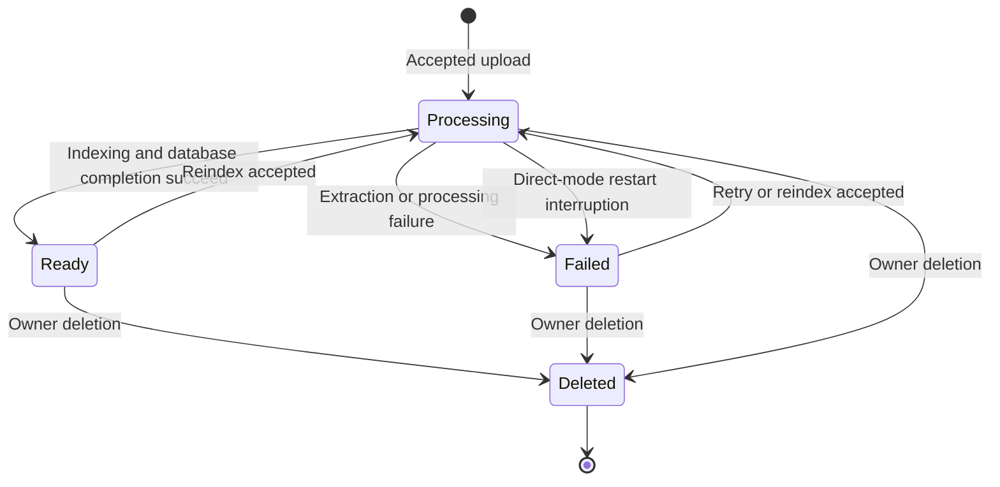

# PRD: application workflow and API changes

Snapshot: 2026-10-08. Parent: [PRD.md](PRD.md). Status: as-built behavior unless explicitly limited.

## Objective

Make registration, uploads, document inspection, document-scoped chat and profile persistence agree across UI, Express and ML. Resolve the visible workflow failures without claiming that every earlier screenshot's root cause can be recovered from history.

## Functional change register

| ID | Implemented change and behavior | Source reference | Acceptance condition |
|---|---|---|---|
| APP-01 | Chat sends `{question}`, not `{content}`. Its final return type is `{userMessage,assistantMessage}`. In queue mode the intermediate `{jobId}` is polled before returning the exchange. | `frontend/src/hooks/useChat.ts:useSendMessage`; `backend/src/controllers/chat.controller.ts:sendMessage` | Direct and queued chat both produce a complete correctly typed exchange. |
| APP-02 | Citation snake_case is normalized once in backend before JSONB persistence; camelCase input is accepted as fallback. Fields: documentId, documentName, pageNumber, chunkId, excerpt, relevanceScore. | `backend/src/services/chat.service.ts:normalizeCitations` | Stored and returned assistant citations match frontend types. |
| APP-03 | Display/search/select/delete prompts use originalName rather than generated disk filename. ML receives document_name and uses it as chunk source_filename. Generated name remains internal metadata and still appears in the DTO; it is not renamed on disk. | document cards/detail/dashboard/chat selection; `DocumentService.createDocument`; `MLService.processDocument`; `PDFService.process_document` | UI and source citations show the uploaded filename. |
| APP-04 | Document DTO excludes filePath and unused mlDocumentId from list/detail/upload responses. Status explicitly returns id/status/pageCount/errorMessage/analysis. | `backend/src/utils/document.dto.ts:toDocumentDto`; `DocumentController` | API JSON has no internal file path or ML ID. |
| APP-05 | Authenticated owner-checked PDF streaming at GET `/api/v1/documents/:id/file`, PDF MIME type and inline original-name disposition. | `DocumentController.streamDocument`; `DocumentService.resolveFilePath` | Owner renders PDF; foreign user is denied; missing file yields an error rather than a fabricated file. |
| APP-06 | PDF viewer uses cookie credentials, local version-matched worker, disabled PDF.js dynamic evaluation, local layer CSS, page navigation and zoom clamped to 0.5–3.0. Viewer is client-side lazy loaded. | `frontend/src/components/documents/PDFViewer.tsx`; detail page; `scripts/copy-pdf-worker.cjs` | Canvas renders with local worker; navigation/zoom controls are labeled and bound. |
| APP-07 | Shared error helper reads `response.data.error.message`, then legacy message/error.message/fallback. HTTP 401 sends protected pages to login but does not redirect login/register to themselves. | `frontend/src/lib/api.ts:getApiErrorMessage` and interceptor | User receives meaningful generic backend errors without redirect loops. |
| APP-08 | Registration password minimum is eight characters in frontend and backend. Auth-page middleware no longer treats any stale cookie as reason to redirect away from login/register. | register page; auth validator; `frontend/src/middleware.ts:middleware` | Short password is rejected; stale/invalid cookie permits reauthentication. |
| APP-09 | Removed global JSON Content-Type for all Axios requests; upload explicitly uses multipart FormData. Backend and ML share the same upload location in Compose. | `frontend/src/lib/api.ts`; `useUploadDocument`; `docker-compose.yml` | File arrives as multipart binary instead of serialized JSON. |
| APP-10 | Stored Windows/relative paths are normalized by basename under configured UPLOAD_DIR before processing/view/deletion. Absolute readable source path is sent to ML. | `DocumentService.resolveFilePath`; `JobService.workOnce` | Historical stored separators do not cause the prior relative-path PDF-not-found failure. |
| APP-11 | Document lists/status poll every three seconds only while processing/pending; reindex and delete invalidate relevant React Query caches, including chat sessions after deletion. | `frontend/src/hooks/useDocuments.ts` | Ready/failed state and removal become visible without continuous polling afterward. |
| APP-12 | Document-specific Start Chat creates a session for that ready document. Empty-scope chat is rejected with NO_DOCUMENTS; selected documents must exist, belong to caller and be ready. | document detail page; `ChatService.createSession`, `sendMessage` | A document-specific chat cannot silently search an unrelated collection. |
| APP-13 | Profile name saving calls a real backend mutation and invalidates auth state. Email/account creation date remain read-only. Unimplemented Delete Account is disabled honestly. | settings page; `frontend/src/hooks/useAuth.ts:useUpdateProfile`; `backend/src/controllers/user.controller.ts:UserController.updateMe` | Saved name persists after reload; account deletion does not pretend to work. |
| APP-14 | Repaired chat scroll viewport, flexible/min-width layout, primary button foreground/background theme contrast, pending controls, accessible citation expansion and labeled send/PDF/retry/delete actions. | ChatInterface/CitationCard/DocumentCard/PDFViewer; app layout; globals.css; UI button | Controls remain visible; citation expands with keyboard; desktop/mobile content does not force page-width overflow. |
| APP-15 | Frontend standalone build/start copies required public/static assets, creates public directory, builds/copies local PDF worker and uses output standalone. | next.config.js; Dockerfile; `scripts/start-standalone.cjs`; package.json; `public/.gitkeep` | Production startup serves JS/CSS/worker/PDF controls rather than a blank shell. |

APP-14 describes current behavior and recorded UI repairs. With no original source snapshot, the exact original invisible-button CSS regression cannot be proven line-by-line. Simulated upload progress remains simulated; it is not network-byte or ML-stage progress.

## Document lifecycle

Deletion is allowed by current service code even while processing; there is no implemented cancellation contract. External indexing/deletion and local row deletion are not one atomic operation, so this diagram does not guarantee race-free deletion.

## API contracts affected

All Express paths below have `/api/v1` prefix. Protected document/chat/job/user routes use authenticate and resource checks. Mutating requests require exact allowed Origin even when bearer auth is used.

| Operation | Request | Response / behavior |
|---|---|---|
| POST `/auth/register` | email, name, password | HTTP 201 sanitized user, not an automatic login token |
| POST `/auth/login` | email, password | HTTP 200 `{success:true,data:{user}}`; token in cookie only |
| POST `/documents` or `/documents/upload` | Multipart `file`; key required in queue mode | HTTP 201 document DTO in both modes |
| GET `/documents`, `/documents/:id` | Cookie/bearer; UUID where relevant | Document DTO/list, including originalName and analysis |
| GET `/documents/:id/status` | Owner-authenticated ID | status, pageCount, errorMessage, analysis |
| GET `/documents/:id/file` | Owner-authenticated ID | PDF binary, not JSON/filePath |
| POST `/documents/:id/reindex` | Key required in queue mode | HTTP 200 data: success/message and queue jobId when enabled |
| DELETE `/documents/:id` | Owner-authenticated ID | HTTP 200 success/message; session arrays cleaned |
| POST `/chat` | title and documentIds | HTTP 201 session; ready/owner checks |
| POST `/chat/:id/messages` | `{question}` and queue key | HTTP 201 exchange directly; HTTP 202 jobId/status when queued |
| GET `/chat/:id/messages` | Owner-authenticated session | Chronological message list |
| GET `/jobs/:id` | Owner-authenticated job | Status/audit envelope; decrypted result only for owner; foreign owner 404 |
| PATCH `/users/me` | name | Sanitized persisted user/profile response |
| GET `/health` | No auth | Liveness; does not check DB |
| GET `/health/readiness` | No auth | 200 when database/ML/Redis/queue checks true, else 503 |

Other unchanged auth/session endpoints are described in PROJECT_CONTEXT.md. These PRDs explain changes rather than duplicating every unrelated CRUD field. Error envelopes normally use `{success:false,error:{code,message}}`; 404 catch-all lacks a code, and validation adds details. No claim of a single generated frontend/backend schema is made.

## State and persistence

React Query owns server state and invalidation; component state owns selected files, input text, dialogs, zoom and citation expansion. Axios unwraps Express data envelopes and sends cookies. Chat input remains pending while the queue job is polled up to 600 iterations, with a one-second delay per unfinished result; elapsed time may exceed ten minutes because HTTP latency is additional. A timeout stops UI waiting, not the server job. New submissions generate new keys; automatic durable offline intent replay is not implemented.

PostgreSQL persists users, document metadata/analysis, chat sessions, messages and jobs. The original PDFs remain server-side. The application does not store a base64 copy of the PDF in the frontend or create irreversible OCR rewrites.

## Known limits

Account deletion is absent. Processing progress is simulated. No committed frontend component/E2E suite exists; browser QA is an external harness. No pagination is implemented. Auth middleware checks cookie presence for navigation, not JWT validity; Express performs actual verification. Legacy documents need reindexing for new analysis/embedding collections. Deletion file/vector effects cannot roll back with PostgreSQL.
