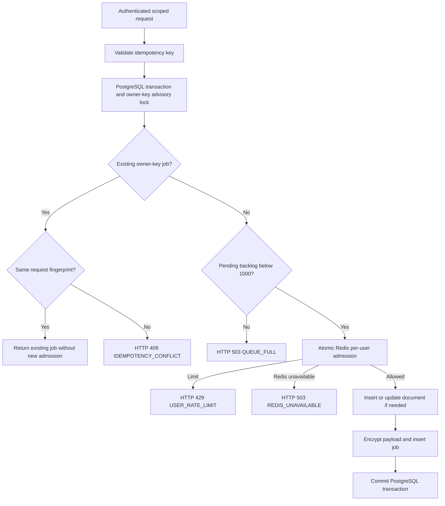
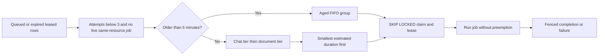
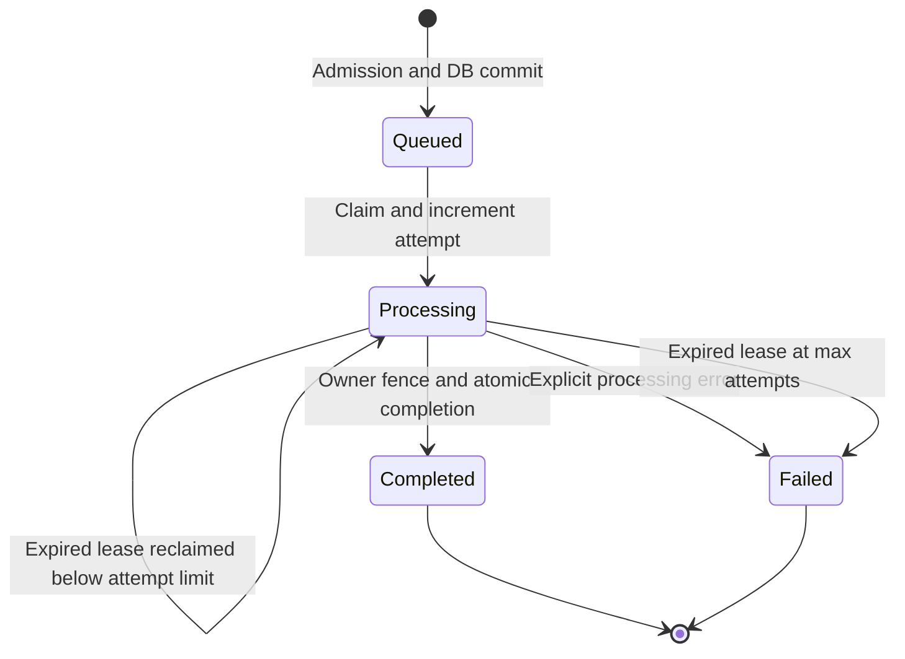
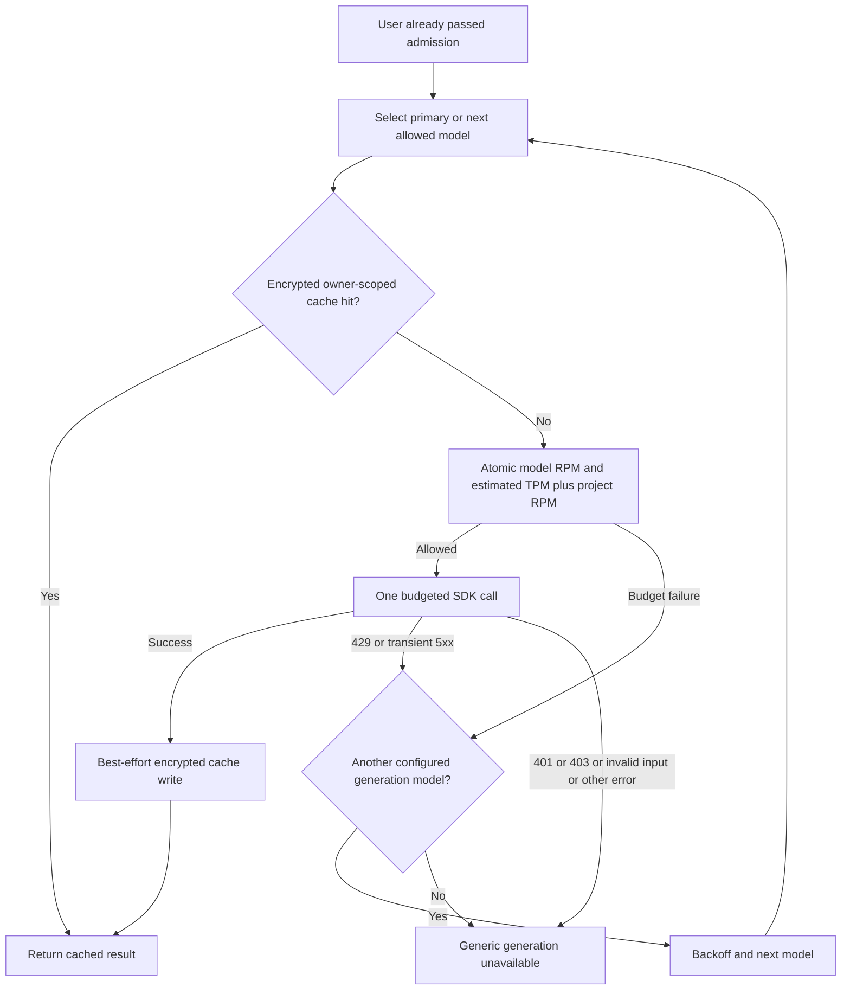
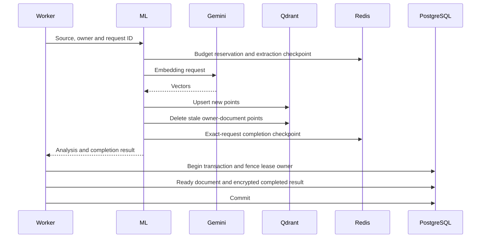

# PRD: durable request orchestration

Snapshot: 2026-10-08. Parent: [PRD.md](PRD.md). Core source: backend JobService/request-security and ML ProviderControl.

## Objective

Coordinate accepted user requests, provider quotas, retries and completion so repeated client requests do not create duplicate local jobs; short eligible work is preferred; secrets and sensitive queued payloads are not stored as plaintext; interrupted work has an explicit recovery boundary.

## Requirement register

| ID | Implemented requirement | Source reference | Acceptance / boundary |
|---|---|---|---|
| ORCH-01 | Queue mode for chat, upload and reindex; direct mode remains configurable. PostgreSQL stores durable jobs; chat returns 202 and owner polls status. | JobService; DocumentService; ChatController; frontend useSendMessage | Queue survives process-local memory loss; Redis is not misrepresented as job authority. |
| ORCH-02 | Idempotency key 16–128 ASCII letters/digits/underscore/hyphen; per-owner keyed digest and body fingerprint; DB lock serializes same-key submission. | `validateIdempotencyKey`, `JobService.enqueue`; idempotency middleware | Same key/body returns existing job; same key/different fingerprint 409. |
| ORCH-03 | Admission uses atomic Redis Lua fixed window, default 20 accepted new jobs per user/minute; exact replay does not consume this admission again. | request-security.ts:admitUser/WINDOW_LIMIT_SCRIPT | Third request rejected at a configured two-request test limit; Redis outage 503, no bypass. HTTP route limits still apply to replay. |
| ORCH-04 | Atomic DB preparation combines accepted document metadata/status with job creation; user/key unique constraint and active-resource partial index. | JobService.enqueue; job.model.ts; migrations 0002/0003 | Accepted upload/reindex does not persist one of job/document DB changes without the other. Redis admission is external and may be consumed even if DB rollback occurs. |
| ORCH-05 | Chat priority 0, document/reindex 1; estimated shortest-first within tiers; jobs older than five minutes promoted FIFO ahead of new jobs. | JobService.enqueue/workOnce | Ordering matches priority/SJF/aging tests; no preemption claim. |
| ORCH-06 | DB row claim with SKIP LOCKED, resource exclusion, unique lease owner, two-minute lease, 30-second renewals, max three claims. | JobService.workOnce/start | Independent workers cannot validly commit the same active resource; stale owners are fenced. |
| ORCH-07 | Fenced atomic completion for chat exchange/job result and document readiness/analysis/job result. | JobService.fence/complete; ChatService.sendMessage | Failed remote call produces no user-only message; lost lease cannot commit success. |
| ORCH-08 | SHA-256 source checksum before and after queued processing; unchanged original PDFs retained; extraction/index/completion checkpoints. | fileChecksum; JobService.workOnce; PDFService.process_document; ProviderControl.checkpoint | Source change raises SOURCE_CHANGED; checkpoints do not replace original source or authoritative DB job. |
| ORCH-09 | Exact owner/request/document completion checkpoint used for timeout reconciliation; not merely vector existence. | MLService.recoverProcessingTimeout; ProviderControl.completion | Partial/older indexing is not labeled successful completion of a timed-out request. |
| ORCH-10 | AES-256-GCM seals job payload/results and Redis caches/checkpoints; HMAC digests identify private cache/key scopes; bcrypt stays password-only. | request-security seal/unseal/digest; ProviderControl get/put/fingerprint | Tampered or wrong-associated-data ciphertext rejected; raw idempotency key not in owner-visible job envelope. |
| ORCH-11 | User-scoped encrypted model/config/content cache, generation TTL 300s, embedding TTL 3600s, checkpoints 86400s. | ProviderControl.cache_key/get/put/checkpoint; embedding/LLM services | Another user's inputs do not reuse private cached text; cache write failure does not discard completed inference. |
| ORCH-12 | Atomic model RPM/estimated TPM/shared-project RPM reservations before each explicit upstream attempt. | ProviderControl.reserve/RESERVE | Shared project cap still enforced on fallback; SDK-internal retries disabled. |
| ORCH-13 | Generation falls back only on configured budget failure or HTTP 429/500/502/503/504; not bad credentials, malformed input or safety refusal. | LLMService.generate | Fallback follows allowed policy; exhausted permitted attempts yield GENERATION_UNAVAILABLE. No automatic embedding swap. |
| ORCH-14 | Owner-visible status/audit JSON; stage events, attempts, schedule estimates and errors; metadata logs use request IDs/user digests rather than source text/raw keys. | JobService.get/workOnce; job.routes.ts; REQUEST_TRANSACTION.schema.json; ProviderControl.audit | Owner can trace request job; foreign owner gets 404. Audit is brief stage metadata, not every SQL/provider substep. |

## Admission and idempotency algorithm



Fingerprint inputs: chat `{sessionId,question}`; upload `{checksum,originalName}`; reindex `{id,checksum}` plus operation kind. Serialized JSON is HMAC-SHA256 keyed with JWT_SECRET; lookup digest rotation therefore depends on JWT secret rotation. Advisory lock key derives from owner plus digest. Jobs retain keys indefinitely; replay returns terminal failures too rather than automatically creating a new attempt. A deliberate retry uses a new key.

The soft backlog cap is a count under the transaction but no global admission lock: concurrent distinct requests can exceed 1000. Exact replay bypasses shared job admission, but general/upload/chat HTTP limiters can still reject it before JobService. Upload replay happens after bytes are saved and can leave an additional file; byte-level upload idempotency is not implemented.

## Scheduling algorithm

Order eligible rows lexicographically:

1. Aged group: created more than five minutes ago before all non-aged rows.
2. For non-aged rows: priority 0 chat, then priority 1 document/reindex.
3. Within non-aged equal-priority rows: smallest estimatedMs first.
4. Oldest createdAt resolves ties; aged rows ignore priority/estimate and use FIFO.

Estimates: chat `5000 + question.length * 10` milliseconds; document/reindex `fileSize / 30`, rounded and clamped to 1–600000 ms. These are heuristic scheduling scores expressed as ms, not benchmarked durations or a prediction model. They omit page count, OCR/GAN mode, cache hit, GPU availability and quota waits.



Example: non-aged document estimates 40000/8000 and chat estimates 9000/6000 dispatch as chat 6000, chat 9000, document 8000, document 40000, absent other constraints. An aged document goes before those new jobs. An already running 40000 job is not interrupted. Two default workers may execute jobs concurrently; start order is not guaranteed finish order. The algorithm is priority-based non-preemptive estimated SJF with aging, **not** global shortest-job-first across tiers or shortest-remaining-time preemption.

## State, leases and failure



Worker loop polls every 500ms after a workOnce completion; default concurrency two, allowed configuration 1–8. Claims renew two-minute leases; renewal errors are swallowed, so fencing on final commit is essential. Crash reclaims are limited to three total claims. Explicit failures are terminal immediately, not three retries of the entire document; embedding attempts and generation model fallbacks are separate inner policies. The active-resource DB partial index complements the eligibility query. A fence checks matching lease owner and processing state, not an independent provider transaction lock.

Direct-mode startup marks all processing documents failed with `Interrupted by restart`. Queue-mode startup relies on job recovery rather than that blanket update. Queue start marks expired attempt-exhausted jobs failed; workOnce also propagates certain exhaustion updates to processing documents. Review this startup/exhaustion interaction: an already failed job may leave its document processing because the later propagation only selects still-processing jobs. This is a discovered code fragility, not fixed by these documentation files. Legacy processing documents with no jobs also have no queue recovery path.

## Provider budgets, cache and fallback



Defaults per model: 10 RPM and 100000 estimated TPM; shared project 60 RPM. Redis Lua checks all three before incrementing and gives first increment a 60-second expiry. These are fixed windows starting with first reservation, not sliding-window/token-bucket limits. Model/request fingerprints are keyed by ML_SERVICE_TOKEN; cache contents are owner-scoped, budgets are shared by configured model/project.

Token estimate: embedding raw text characters divided by three; generation prompt characters divided by three plus configured output limit. This is approximate, excludes some instruction/prefix/reasoning accounting and cannot guarantee provider TPM compliance. Denied attempt is not refunded/rolled into a precise consumption receipt. Provider budgets are configuration, not discovered account quotas.

Generation model list deduplicates primary plus comma-separated fallbacks. Backoff is one then two seconds with default three models, bounded at four seconds for longer lists. Auth/safety/malformed failures do not trigger model cycling. Redis read/decryption/reservation failure is ProviderLimited and fails closed; it may try another generation model but cannot successfully bypass the unavailable shared coordinator. Cached results require no provider reservation. Successful-result cache write failure warns and returns the inference result. Embeddings never change model on rate limit because another embedding space would invalidate indexed vectors.

## Encryption and transaction boundary

Backend ciphertext envelope: `v1.base64(nonce).base64(tag).base64(ciphertext)` with fresh 12-byte nonce, 32-byte separate key, 16-byte GCM tag. Associated data is `jobId:userId:kind`. JSON payload includes owner ID/raw idempotency key; job lookup/audit exposes only digest. Redis uses nonce followed by AESGCM encrypted JSON/tag and cache-key associated data. Neither is bcrypt encryption: bcrypt hashes passwords with cost 10 and is intentionally non-reversible.



PostgreSQL can atomically persist paired local changes. Gemini, Qdrant, source filesystem and Redis do not join that transaction. A crash after upstream success before cache/DB write may repeat billable calls; partial vector replacement may leave stale points; checksums detect source change but do not undo already indexed changed chunks. AOF everysec can lose recent coordination/cache writes. This is **at-least-once external execution with local transactional completion**, not distributed ACID or exactly-once billing.

## Job/audit JSON contract

Authoritative schema: `REQUEST_TRANSACTION.schema.json`. `JobService.get` returns these owner-visible fields:

```json
{
  "id": "00000000-0000-4000-8000-000000000001",
  "userId": "00000000-0000-4000-8000-000000000002",
  "kind": "chat",
  "resourceId": "00000000-0000-4000-8000-000000000003",
  "status": "completed",
  "attempts": 1,
  "errorCode": null,
  "priority": 0,
  "estimatedMs": 5090,
  "createdAt": "2026-10-08T00:00:00.000Z",
  "updatedAt": "2026-10-08T00:00:01.000Z",
  "scheduling": "priority-and-non-preemptive-estimated-SJF-with-aging",
  "idempotencyKeyHash": "synthetic-digest-not-a-real-key",
  "events": [
    {"stage": "queued", "at": "2026-10-08T00:00:00.000Z"},
    {"stage": "processing", "at": "2026-10-08T00:00:00.100Z", "attempt": 1},
    {"stage": "committed", "at": "2026-10-08T00:00:01.000Z", "attempt": 1}
  ],
  "result": {"userMessage": {"content": "check pnr"}, "assistantMessage": {"content": "Source-derived answer", "citations": []}}
}
```

Illustrative values and abbreviated nested messages above are explanatory, not a full schema-valid production record. Actual messages include normal DB fields. Result is null before completion; document results contain documentId/status. Event metadata includes request/digest identifiers where authored; ML provider attempts are separately logged, not merged automatically into the DB events array. Audit is owner-readable and operationally useful, not a complete financial ledger or tamper-proof immutable log.

## Outstanding requirements

Durable browser intent/key retention; portable key backup/rotation; job retention; cancellation/dead-letter/retry administration; graceful shutdown; per-resource deletion coordination; reconciliation after DB/remote divergence; authoritative measured job-cost estimates; exact provider quota accounting; and tested server/database recovery. Queue admission is durable coordination, not a guarantee of no data loss in every failure.
