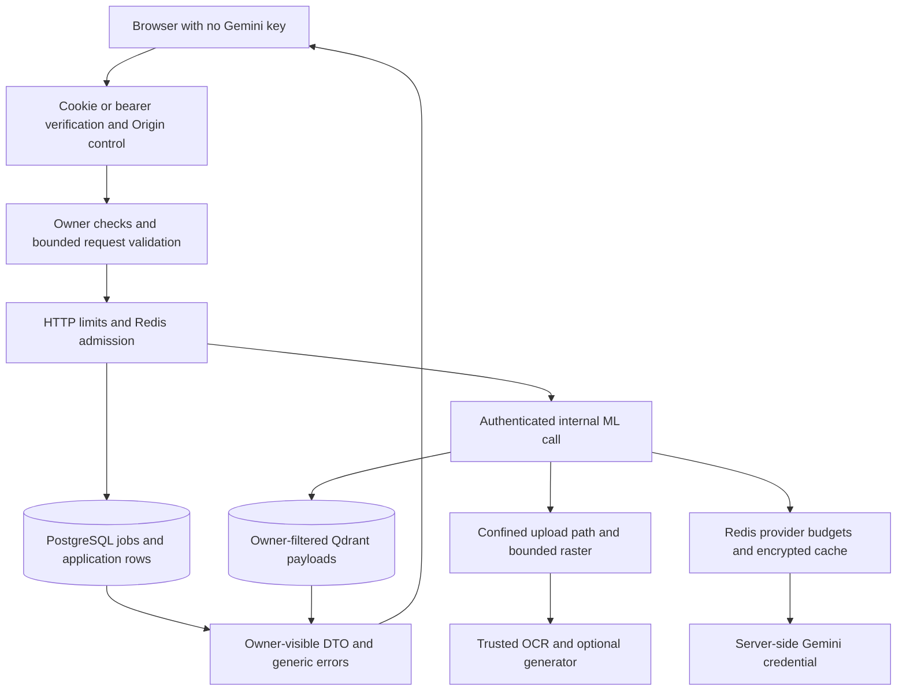
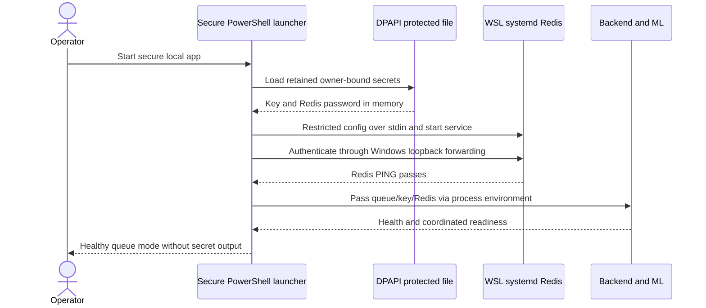

# PRD: security, deployment and verification

Snapshot: 2026-10-08. Parent: [PRD.md](PRD.md). This is a source-backed readiness explanation, not a penetration-test certification.

## Security change register

| ID | Implemented control | Source reference | Remaining boundary |
|---|---|---|---|
| SEC-01 | Login JSON no longer returns token. Cookie httpOnly, sameSite lax, secure in production. JWT verification accepts HS256 only and checks user still exists. | AuthController.login; auth.middleware.ts:authenticate | Bearer auth still accepted; no revocation/MFA. Cookie maxAge fixed seven days while JWT expiry configurable. |
| SEC-02 | Exact CORS_ORIGIN required on non-GET/HEAD/OPTIONS requests, including login/register and bearer clients; credentialed CORS. | origin.middleware.ts:verifyMutationOrigin; app.ts | No independent CSRF token; clients without Origin fail. Allowed deployment hostname needs configuration. |
| SEC-03 | No ML default token; min 32 chars required at Settings startup; constant-time comparison. | ML config.py:Settings; auth.py:verify_token | Shared service token grants broad internal access; ML must not be public. Health is unauthenticated. |
| SEC-04 | ML resolves realpath and confines file to configured upload root for process/reindex; backend basename-normalizes historical stored paths. | PDFService.process_document; DocumentService.resolveFilePath | PDF parser/resource sandbox not implemented; basename normalization is not a full malware or symlink policy. |
| SEC-05 | Upload MIME check, one file, five fields/six parts, configured maximum size default 50 MiB, `%PDF-` magic after disk save. Invalid upload removed asynchronously and returns 400. | upload.middleware.ts:uploadPDF/validatePdfSignature | Signature does not prove well-formed/safe PDF. No antivirus/page count/storage quota. |
| SEC-06 | Express unhandled failures generic INTERNAL_SERVER_ERROR; ML processing/chat/reindex failures generic codes/messages; specific known auth/validation errors remain meaningful. | error.middleware.ts:errorHandler; ML API routes/main.py | Server logs retain raw internal exceptions. Validation responses have details; AppError/Multer messages remain exposed. Not all responses are identically shaped. |
| SEC-07 | Layered rate limits and bounded request shapes: question 8000 chars, title 200, documents 20, JSON 64 KiB, general 600/15min, auth 10/15min, uploads 3/user/min, chat 20/user/min; queue/provider Redis limits added. | app.ts; chat/document routes; chat.validator.ts; ML schemas | General/auth/route limiters are process-local, not distributed. No total user storage quota or trusted proxy policy. |
| SEC-08 | Ownership checks protect document/session/file/job APIs; Qdrant filters owner and selected documents. Document deletion removes ID from owner's session arrays in same DB transaction. Safe asynchronous filesystem unlink. | ChatService/DocumentService; JobService.get; QdrantService | Vector removal best-effort on ML failure; disk deletion before DB transaction cannot roll back. Job/deletion race unresolved. |
| SEC-09 | Sensitive durable payload/results and configured Redis caches encrypted; default PDF.js eval disabled; model loading rejects arbitrary state_dicts and disables reranker remote code. | request-security; ProviderControl; PDFViewer; CGANService; RerankingService | Existing normal chat/user/analysis/PDF/vector text is not universally encrypted. Trusted upstream GAN code still executes. |

## Trust-boundary diagram



The Gemini key lives in server-side ML configuration only. The source cannot establish Google project restrictions, billing caps, rotation history or cloud IAM. Those remain deployment checks. No credentials, secret values or private PDF contents are included in this pack.

## Operations/hygiene change register

| ID | Change | Source | Acceptance / status |
|---|---|---|---|
| OPS-01 | Generated Drizzle migrations are retained as source; compiled migration runner applies ./drizzle and runtime Docker image copies migrations. | backend/drizzle; src/db/migrate.ts; backend/Dockerfile | Isolated migrations passed; no Git repository exists, so no commit was made. |
| OPS-02 | Backend tests refuse database names without test; fresh temporary upload dirs; test Compose database profile/5433; real Jest mocks replace undeclared adapter placeholder. | tests/test-guard.ts; test-cleanup.ts; ml.service.test.ts; compose | Tests do not operate on production upload directories. A name substring guard is not infrastructure isolation by itself. |
| OPS-03 | Git/Docker ignores cover dependencies/builds, secrets, uploads, native binaries/data, archives/tools; duplicate httpx removed, unused sonner/uuid and obsolete tooling removed; README health claims corrected. | .gitignore; three .dockerignore files; requirements/package manifests; README | Ignore is not deletion. Existing protected runtime/data folders remain. |
| OPS-04 | Native startup validates listeners, runs migrations/health checks, preserves existing services; standalone frontend assets/start fixed; secrets-aware launcher verifies Redis before restarting known app processes. | scripts/start-local.ps1/start-secure-local.ps1; frontend/scripts/start-standalone.cjs | Current local app/readiness healthy. Normal start-local alone does not load DPAPI secrets; use secure launcher for retained queue configuration. |
| OPS-05 | Real Redis 7.4.11 extracted from official signed APT packages into separate WSL prefix; dedicated hardened service; existing WSL Redis preserved. | scripts/install-local-redis.ps1; redis-packages.list; documind-redis.service | Real authentication/admission/AOF settings checked, not emulator. Ubuntu 24.04 amd64 required; no Docker installation. |
| OPS-06 | Retained separate encryption key and Redis password via Windows CurrentUser DPAPI; owner/SYSTEM ACL; reject replacement when jobs exist or existing managed Redis config has no retained secret file. | scripts/runtime-secrets.ps1:Get-DocuMindRuntimeSecrets; start-secure-local.ps1 | Key reused on restart; no `.env` edit or credential output. Backup/rotation not implemented. |
| OPS-07 | Patched dependency upgrades and scoped overrides, runtime-compatible checks, matched generated worker. | frontend/backend package.json/lockfiles; ML requirements; frontend configs | Audits clean in last recorded pass; no forced downgrade of application to silence audit. |
| OPS-08 | Real Redis verification script exercises unauthenticated denial, AES roundtrip/wrong-AAD rejection and atomic admission, then persistence configuration/manifest. | scripts/verify-local-redis.ps1/.cjs | Checks pass without Redis flush or production data deletion. Not a power-loss/restore test. |
| OPS-09 | Dependency readiness endpoint checks DB, ML, Redis and queue enabled; native health and browser checks separated from security certification. | backend/src/routes/health.routes.ts; ML health routes | Readiness HTTP 200 after final restart. Liveness alone not proof of dependencies, Gemini quota or readiness. |

## Schema/migration changes

| Migration | Purpose |
|---|---|
| 0000_unusual_vulture.sql | Establish baseline application tables/indexes according to retained schema |
| 0001_redundant_pestilence.sql | Document analysis JSONB |
| 0002_equal_giant_girl.sql | request_jobs durable encrypted request/result, owner-key uniqueness, schedule/lease/attempt/error/events fields |
| 0003_watery_arclight.sql | Unique processing job per resource via partial index |

Associated snapshots/journal accompany generated migrations. The partial-index WHERE predicate was manually corrected because the earlier generator omitted it; future generated migrations need predicate review. Settings save uses existing user fields, not a new user profile table. Internal mlDocumentId remains unused in DB and excluded from DTO.

## Dependency changes with functional consequences

Manifest ranges are not the same as exact installed versions. Node lockfiles retain resolved versions; Python direct requirements are exact pins, but all transitive packages are not locked. Full current package inventories remain in manifests rather than repeated here.

| Layer | Change | Why / associated adaptation |
|---|---|---|
| Frontend | Next 14 to manifest ^15.5.27; React/DOM ^18.3.1 retained compatible major | Patched runtime; outputFileTracingRoot pinned to frontend; serverExternalPackages replaces old experimental option |
| Frontend | React-PDF ^10.5.0 with matching installed PDF.js 5.4.296 | Patched PDF parsing; CSS import paths changed; local worker becomes .mjs and is copied each build |
| Frontend | Tailwind ^4.3.3, @tailwindcss/postcss ^4.3.3, PostCSS ^8.5.29 | New PostCSS plugin; CSS @import/@config; darkMode class config; existing semantic button/theme colors retained |
| Frontend lint | eslint-config-next fixed 14.2.35 while runtime Next 15; scoped glob ^10.5.0 and PostCSS override | Avoid vulnerable dependency path in newer lint plugins; lint command uses ESLint directly; not a runtime Next downgrade |
| Backend | Drizzle ORM ^0.45.3 and Kit ^0.31.11 | Modern config dialect postgresql and dbCredentials.url; existing migrations exercised |
| Backend | Multer ^2.0.2; Jest ^30.5.2, types ^30, Supertest ^7.1.4, ts-jest ^29.4.14 | Remove vulnerable paths while retaining contracts; API tests verify upload/mock behavior |
| Backend tooling | tsx replaces ts-node-dev; unused uuid/types removed; scoped esbuild ^0.25.12/js-yaml ^4.1.1 overrides | Removes tooling vulnerabilities; YAML loading/unsafe-tag rejection regression tests added |
| ML runtime | FastAPI 0.142.4/Starlette 1.7.0, Pydantic 2.12.5/settings 2.15.0, httpx 0.28.1/multipart 0.0.32/dotenv 1.2.4 | Compatibility/security updates verified by requirements resolution and pytest |
| ML PDF | PyMuPDF 1.28.2, pdfplumber 0.11.10, Pillow 12.3.0 | Patched parser/image dependencies; import pymupdf as fitz avoids deprecated-module warning interfering with fixture output |
| ML models | Sentence Transformers 6.1.0, Transformers 5.19.0, docTR 1.1.0 | Compatible patched HF/model dependency chain and newer docTR weights; real OCR/reranker exercised; trust_remote_code=False |
| ML provider/vector | Earlier google-generativeai 0.3.2 to google-genai 2.26.0; Qdrant client 1.7.3 to 1.19.1 | Modern SDK/content API and query_points; models/collection migrations documented in OCR/RAG PRD |
| ML coordination | Redis 5.3.1/cryptography 50.0.2, fakeredis Lua test dependency | Encrypted cache/budget tests; real production Redis does not use fakeredis |
| ML hygiene | Unused local transitive NLTK removed; duplicate httpx requirement removed; pytest 9.1.1/asyncio 1.4.0 | Removes unused vulnerability surface and maintains 49 passing tests |
| Docker | Node base 22, Qdrant 1.19.1, Redis 7.4 Alpine, Postgres 16; neural OCR/upstream checkout in ML image | Docker contexts exclude secrets; shared upload volume and environment credentials; no local Docker build evidence |

No Gemini model swap occurred in the most recent Redis/dependency remediation. Earlier model migration and current in-memory legacy mappings are explicitly described in PRD_OCR_RAG.md. Availability statements from prior work are historical checks, not current support guarantees.

## Local deployment and secrets



Redis binds 127.0.0.1/::1, port 6380, protected mode, password auth, AOF everysec, 256 MiB/noeviction. Native data is `/var/lib/documind-redis`; binaries separate under `/opt/documind-redis`; restricted config `/etc/documind-redis.conf`; systemd user redis with NoNewPrivileges/PrivateTmp/ProtectHome/ProtectSystem/read-write path restrictions. A retained hidden WSL session keeps WSL alive. Windows secret path: `.tools/secrets/runtime-secrets.clixml` (ignored). Raw secret values are never documented.

Generate 32 random key bytes base64 and 32 random password bytes hex only on first safe provisioning; retain SecureString via Export-Clixml, owner SID check on load. Directory allows owner and SYSTEM. Backend/ML share separate DATA_ENCRYPTION_KEY. Launcher restores original environment values in finally; it does not persist them in `.env`. Windows administrators/process inspection still form part of the trust boundary. DPAPI is not portable cloud secret management; the secret file alone cannot recover from profile/machine loss. No full recovery drill performed.

## Local commands

From project root, initial Redis install is WSL Ubuntu-24.04 amd64-specific and requires curl/gpg and a redis OS account:

```powershell
./scripts/install-local-redis.ps1
./scripts/start-secure-local.ps1
./scripts/verify-local-redis.ps1
# Subsequent start when compiled outputs are current:
./scripts/start-secure-local.ps1 -SkipBuild
```

Application dependencies/checks, run in each corresponding directory:

```text
frontend: npm ci
frontend: npm run lint
frontend: npx tsc --noEmit
frontend: npm run build
frontend: npm audit
frontend: npm audit --omit=dev
backend: npm ci
backend: npm run build
backend: npm run db:migrate
backend: npm test
backend: npm audit
backend: npm audit --omit=dev
ml-service: python -m pip install -r requirements.txt -r requirements-ocr.txt -r requirements-dev.txt
ml-service: python -m pytest -q
ml-service: python -m pip check
ml-service: python -m pip_audit
ml-service: python scripts/benchmark_ocr.py --backend doctr
```

Set DATABASE_URL to a **separate database whose name contains test** before backend tests; supply required JWT/service configuration and matching allowed Origin without printing values. Never use production credentials/test cleanup against production. pip-audit is a separate audit tool, not included in production requirements; install it in a dedicated compatible tooling runtime. The bundled portable Python needed an audit-tool stdlib compatibility repair during previous verification; normal Python installations should provide venv.

For Compose: supply named root Postgres/test/Redis credentials and separate data key, backend JWT/shared ML service token and ML Gemini key from trusted configuration. Run `docker compose up -d --build`, `docker compose exec backend npm run db:migrate`, and restart backend if initial schema startup failed. Test database starts via `docker compose --profile test up -d postgres-test`. Passwords have no hardcoded fallback. URL credentials must be correctly encoded. Docker is absent here; these are configured commands, not verified deployment results.

## Configuration names relevant to changes

No secret values are listed. Existing backend names: NODE_ENV, PORT, DATABASE_URL, JWT_SECRET, JWT_EXPIRES_IN, ML_SERVICE_URL, ML_SERVICE_TOKEN, UPLOAD_DIR, MAX_FILE_SIZE, CORS_ORIGIN. New coordination names: REDIS_URL, QUEUE_ENABLED, DATA_ENCRYPTION_KEY, USER_API_REQUESTS_PER_MINUTE, QUEUE_CONCURRENCY. Frontend: NEXT_PUBLIC_API_URL (public API endpoint only, never a provider secret).

ML names: QDRANT_URL, QDRANT_API_KEY, QDRANT_COLLECTION, LLM_PROVIDER, GEMINI_API_KEY, LLM_MODEL, LLM_TEMPERATURE, LLM_MAX_OUTPUT_TOKENS, LLM_FALLBACK_MODELS, EMBEDDING_PROVIDER, EMBEDDING_MODEL, EMBEDDING_DIMENSION, RERANKER_MODEL, RERANKER_ENABLED, ML_SERVICE_TOKEN, UPLOAD_DIR, CHUNK_SIZE, CHUNK_OVERLAP, RETRIEVAL_TOP_K, RETRIEVAL_TOP_N, LOG_LEVEL, TESSERACT_CMD, REDIS_URL, DATA_ENCRYPTION_KEY, GEMINI_REQUESTS_PER_MINUTE, GEMINI_TOKENS_PER_MINUTE, GEMINI_PROJECT_REQUESTS_PER_MINUTE, OCR_BACKEND, OCR_DEVICE, OCR_TORCH_THREADS, CGAN_REPO_DIR, CGAN_CHECKPOINT, CGAN_CHECKPOINT_SHA256, CGAN_NET_G, CGAN_NORM, CGAN_USE_DROPOUT, CGAN_CHANNELS, CGAN_NGF, CGAN_TILE_SIZE, CGAN_TILE_OVERLAP, CGAN_MAX_TILES.

Compose credential names: POSTGRES_DB, POSTGRES_USER, POSTGRES_PASSWORD, POSTGRES_TEST_DB, POSTGRES_TEST_USER, POSTGRES_TEST_PASSWORD, REDIS_PASSWORD, DATA_ENCRYPTION_KEY. These names describe configurable code, not which values are present on a given host.

## Recorded verification evidence

The following results were recorded in the previous implementation/remediation pass; writing these PRDs does not rerun or renew them.

| Check | Last recorded result | Coverage / qualification |
|---|---|---|
| Backend build and migrations | Passed | Isolated test DB and native startup migration |
| Jest | 30 tests, 6 suites passed | Auth, mocked ML chat, atomicity, documents/access/upload, jobs/encryption/replay/limits/aging/fencing/recovery, tooling YAML |
| ML pytest | 49 passed | Chunking/embedding/schema/RAG, native/scanned analysis/PNR, provider cache/budgets/fallback, neural OCR/tiles/preservation |
| Frontend lint/TypeScript/build | Passed | Next 15 production build; no committed component/E2E test suite |
| npm audits | Zero known advisories, both apps | Full and production-only; point-in-time database |
| pip check / installed-environment pip-audit | Passed / no known vulnerabilities | Includes installed optional OCR stack; no fully transitive Python lock |
| Real Redis verification | Passed | Auth denial, AES/AAD, Lua admission, AOF settings/manifest; not crash restore |
| Real reranker | Passed | Relevant PNR passage ranked above unrelated passage |
| docTR synthetic benchmark | CER/WER zero, mean confidence 92.9% | Clean reference fixture, not messy dataset/GAN benchmark |
| Chromium desktop/mobile | Passed | 1440x1000/390x844, synthetic scanned upload, real OCR/embedding/Qdrant, every-page summary, local PDF viewer, queued PNR/citations/replay/409, no console errors/overflow |
| Native readiness after restart | HTTP 200, all four checks true | Does not probe live Google quotas or certify security |
| Docker / public-production / disaster recovery | Not verified | No Docker engine installed; no public deployment approved |

Browser integration used a separate test PostgreSQL cluster, Redis DB 1, separate Qdrant collection and synthetic uploads. The isolated services were stopped afterward; native app/Redis remain. Earlier queue integration used an emulator, but the latest verification used real Redis. Prior source-backed PNR answer bypassed generation; earlier separate browser runs exercised actual Gemini generation. No original user PDF was deleted or rewritten by remediation. One previous user-requested reindex updated analysis/vectors, not source bytes.

## Outstanding risks and acceptance gates

| Gate | Current status | Needed before a public deployment claim |
|---|---|---|
| Transport/network | Local Redis loopback; Compose ML/Qdrant loopback, but backend/Postgres published and native binding not comprehensively hardened | TLS ingress, firewall/private service network, deployment-specific CORS/proxy review |
| Secrets/recovery | Local DPAPI retention works | Managed key store, provider restrictions/billing caps, tested encrypted backups/restores, rotation/multi-key policy |
| PDF abuse | Byte/raster/tile limits, no full sandbox | Per-user storage/page/work quotas, parser isolation, CPU/RAM/time bounds, malware policy |
| OCR quality | Synthetic validation only; GAN inactive | Representative labeled corpus, digit/date quality targets, language/rotation policy, trained trusted checkpoint |
| Job lifecycle | Durable leases/fencing with known startup/deletion caveats | Cancellation/graceful stop, dead-letter/retry/retention, exhaustion-document reconciliation |
| Transaction completeness | Local DB atomicity, remote at-least-once | Documented compensation/reconciliation; do not advertise distributed ACID/exactly-once billing |
| Privacy at rest | Selected workflow ciphertext only | Deployment disk/database/vector/backup encryption or designed field encryption |
| Auth lifecycle | Cookie/JWT login and user checks | Revocation, account deletion, optional MFA; decide duplicate-email disclosure |
| Scale/regression | No pagination; polling and duplicated contracts | Capacity tests, pagination, resource indices/review, generated contracts, committed E2E suite |
| Dependencies | Current audits clean | Ongoing scans/patch policy and reproducible Python transitive lock |

## Files delivered by this documentation request

`docs/PRD.md`, `docs/PRD_APPLICATION.md`, `docs/PRD_OCR_RAG.md`, `docs/PRD_ORCHESTRATION.md`, `docs/PRD_SECURITY_OPERATIONS.md`. These explain implemented changes and limits; no application-source fixes are silently included. Newly noticed fragilities are recorded rather than changed under a documentation-only request.
